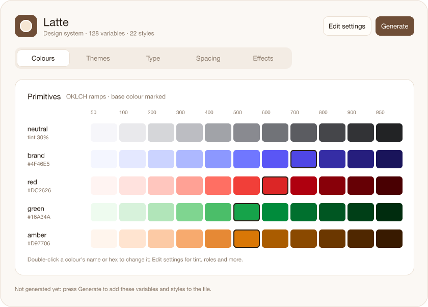
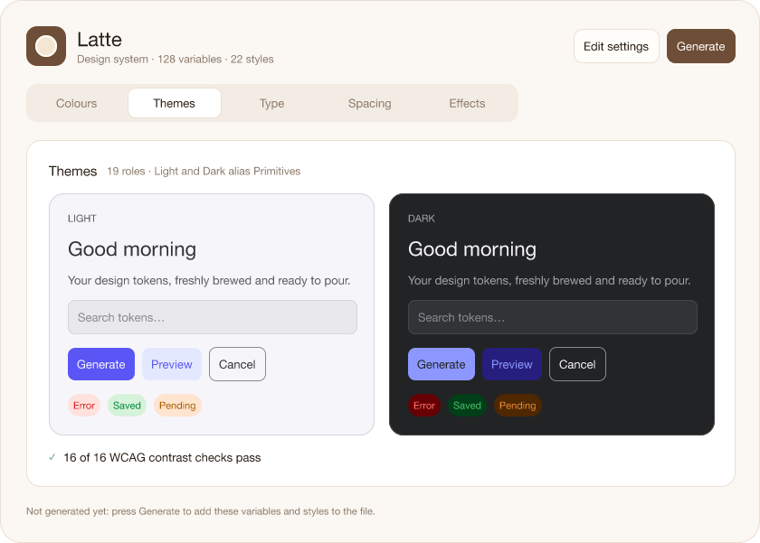

# Latte

Latte is a design-system plugin for [FigCraft](https://github.com/storytold/figcraft). It
turns a few choices into native, reusable **variables** and **styles** in the current document,
and keeps them in sync when you change your mind.

| Collection | What's in it |
|---|---|
| **Primitives** | An OKLCH tonal ramp (50…950) for each brand/status colour, a neutral ramp tinted toward the first colour, `base/white` and `base/black`. Hidden from pickers: designers use Themes. |
| **Themes** | Semantic colours (`bg/*`, `fg/*`, `border/*`, `accent/*`, `danger/*`, `success/*`, `warning/*`, `focus/ring`) with **Light** and **Dark** modes, each an alias of a Primitives step, scoped to fills, text or strokes. |
| **Sizes** | `spacing/*` (multiples of a base unit), `radius/*`, `border/*`, with an optional **Compact** mode. |
| **Typography** | `family/*` (string), `size/*` (a modular scale), `line-height/*`, `weight/*`. |

Styles: 13 **text styles** (Display, Heading H1–H4, Body, Label, Caption, Code) whose family, size
and line height are bound to Typography variables, and **effect styles** (Elevation 1–6, Focus
ring, background Blurs).

## The Latte board

**Plugins ▸ Widgets ▸ Latte** puts the Latte board on the canvas: a live preview of the design
system with tabs for Colours, Themes, Type, Spacing and Effects.




- **Generate** (on the board or in its menu) creates and re-syncs the variables and styles.
- **Edit settings** opens the panel. Every change there redraws the board as you go.
- Double-click a colour's name or hex on the board to change it.
- The board keeps its working settings in its own state, so unsaved edits show up and travel
  with the file. Generate writes them to the document.

The board previews with plain colours in the board's typeface, because widget layers can't take
fonts, effects or variables. Its elevation shadows are approximations. The generated styles are
the real thing.

## The panel

**Plugins ▸ Latte ▸ Open Latte…** opens the panel. Its *Section* menu switches between:

- **Overview**: what Latte will make, and the contrast report.
- **Colours**: up to six named base colours, neutral tint, and a live ramp preview.
- **Themes**: pick a role and choose its ramp and its Light and Dark steps. Failing WCAG pairs are listed at the top (text needs 4.5:1, UI 3:1).
- **Sizes**, **Typography**, **Effects**: the scales, with previews of the values.

**Generate** creates what's missing and updates what changed, in place, so layers bound to the
variables follow. It never deletes, and it leaves variables of another type with the same name
alone (they're listed as skipped). **Plugins ▸ Latte ▸ Generate / re-sync design system** does
the same without the panel. Each run is one undo step.

The config is saved with the document (on its first page) each time you Generate, so everyone
working on the file re-syncs from the same choices. Opening the panel starts from the document's
config: edits you didn't generate are dropped when you reopen it.

## Building

Needs Rust with the WebAssembly target:

```sh
rustup target add wasm32-unknown-unknown
./build.sh          # → dist/latte.wasm + dist/figcraft-plugin.json
cargo test          # colour maths, token plan, panel, and sync against an in-memory document
```

Then in FigCraft: **Plugins ▸ Development ▸ Import plugin from manifest…** and pick
`dist/figcraft-plugin.json`. A rebuilt plugin runs its new code without importing again.

Headless check with a `figcraft-cli` built from the FigCraft repository:

```sh
figcraft-cli run e2e/smoke.jsonl --out /tmp/latte-smoke.figcraft
figcraft-cli run e2e/panel.jsonl
figcraft-cli run e2e/board.jsonl
```

## Layout

```
src/lib.rs            entry point: commands and panel events
src/config.rs         the choices a design system is made from
src/panel.rs          the panel's sections, and merging its values into the config
src/widget.rs         the Latte board widget
src/color/            OKLCH, ramps, WCAG contrast, PNG previews
src/tokens/           the design system as data (one module per collection, plus effects)
src/sync.rs           make the document match the plan (create / update / skip)
```

## Licence

Latte is dual-licensed under either the [MIT licence](LICENSE-MIT) or the
[Apache License, Version 2.0](LICENSE-APACHE), at your option, like FigCraft itself.
